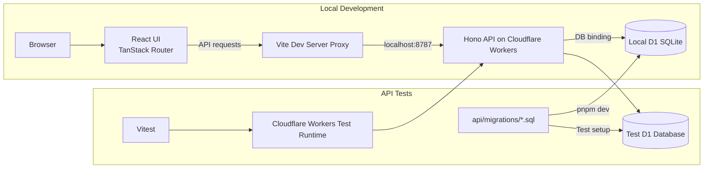
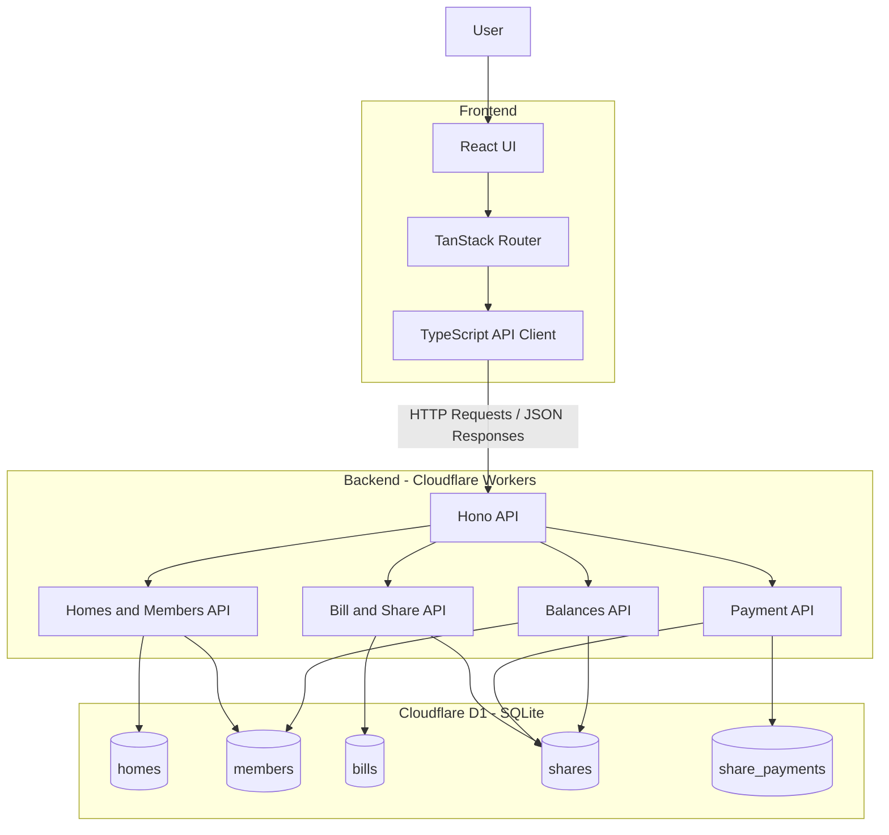

# SDE Intern Assignment: Shared Bill Splitter

Welcome. In this assignment, you build a small bill splitter for a shared home. It has two parts:

1. **Homes and members:** Create a home and add members to it.
2. **Bill splitting:** Split a bill between the members. Each member pays their own share.

The assignment is small on purpose. We want correct, safe, and clear code. We do not want many features.

## What We Look At

- **Your code passes the tests.** The tests decide, not opinion. You get the visible tests. We also run extra tests that you do not see.
- **Your code is safe when things go wrong.** Wrong input, repeated requests, and two requests at the same time must not break your data.
- **Your code is typed.** Use TypeScript. Do not use `any`.
- **You understand your code.** You record a short video and explain it.

Take your time. A careful, correct solution is better than a fast one. We expect 2 to 3 days of real work.

## Stack (Required)

- **API:** Hono on Cloudflare Workers
- **Database:** Cloudflare D1 (SQLite). The binding is `DB` in `api/wrangler.jsonc`.
- **Web:** React, Vite, TanStack Router
- **Language:** TypeScript on both sides
- **Tests:** Vitest, running inside the Workers runtime
- **Quality:** Biome. `pnpm check` and `pnpm typecheck` must pass.

## Architecture

The project uses a serverless full-stack architecture. The frontend communicates with the backend through HTTP API requests, and the backend accesses the database through the Cloudflare D1 binding.

### 1. Local Development and Testing Architecture

The following diagram describes how the application runs locally and how API tests execute in the Cloudflare Workers runtime.



### 2. Application Architecture

This diagram shows the main application components and how the frontend, backend APIs, and database interact.



### 3. Technology Responsibilities

| Component | Technology | Responsibility |
|---|---|---|
| Frontend | React | Builds the user interface and manages UI state |
| Frontend routing | TanStack Router | Handles frontend navigation |
| Development and build | Vite | Runs the frontend development server and builds production assets |
| API client | TypeScript | Sends HTTP requests and handles API responses |
| Backend framework | Hono | Defines API routes and handles requests and responses |
| Backend runtime | Cloudflare Workers | Executes the serverless backend |
| Database | Cloudflare D1 (SQLite) | Stores homes, members, bills, shares and payments |
| Testing | Vitest | Tests API functionality in the Workers runtime |
| Code quality | Biome | Performs formatting and lint checks |
| Package management | pnpm | Manages dependencies and the workspace |

### 4. Main Application Data Flow

1. **Home creation:** The user creates a home through the frontend. The API generates a unique ID and stores the home in D1.
2. **Member management:** Members are added to a home. Their creation order is preserved for bill splitting.
3. **Bill creation:** The API validates the bill amount, retrieves the home's members, calculates individual shares and stores the bill and shares.
4. **Payment processing:** When a user pays a share, the frontend sends a payment request with an `Idempotency-Key`. The backend checks the payment state and prevents duplicate payments.
5. **Balance calculation:** The API calculates each member's outstanding balance by summing their unpaid shares across the home's bills.

### 5. Important Design Considerations

- **Integer-based money calculations:** Monetary amounts are stored as integer cents to avoid floating-point precision errors.
- **Idempotent payments:** Successful payment records are persisted so that retrying the same request does not create another payment.
- **Database integrity:** Named constraints, foreign keys and unique constraints protect relationships and prevent invalid data.
- **Atomic database operations:** Related bill and payment writes are grouped using D1 batch operations.
- **Error handling:** API errors use JSON responses, and the frontend handles loading, empty, timeout and error states.

You choose the rest (styling, form library, validation library). Pick tools you can explain.

## The Task

The assignment has two parts. Do Part 1 first. Part 2 builds on it.

### Database

Write the schema as SQL migration files in `api/migrations/`. For example, `0001_init.sql`. The tests apply every file in this folder.

Your schema must have **at least 3 named constraints** that protect the data. For example, a foreign key, a `CHECK`, or a `UNIQUE` key. Be ready to explain what each constraint stops.

### Errors

Every error response is JSON:

```json
{ "error": "message" }
```

## Part 1: Homes and Members

Create a home and add members to it. The order in which members are added matters in Part 2.

### `POST /api/homes`

**Request:**

```json
{
  "name": "string"
}
```

**Success:** `201`

```json
{
  "id": "home-id",
  "name": "Home Name"
}
```

### `POST /api/homes/:homeId/members`

**Request:**

```json
{
  "name": "string"
}
```

**Success:** `201`

```json
{
  "id": "member-id",
  "homeId": "home-id",
  "name": "Member Name"
}
```

**Errors:**

- `404` Home not found.

Visible tests: `api/test/homes.test.ts`.

## Part 2: Bill Splitting

Add a bill to a home, split it between the members, and let each member pay their share.

All amounts are whole **cents** (integers). `100` cents is 1 dollar. Never use decimals for money.

### `POST /api/homes/:homeId/bills`

**Request:**

```json
{
  "title": "Electricity Bill",
  "totalCents": 1000
}
```

**Success:** `201`

```json
{
  "id": "bill-id",
  "homeId": "home-id",
  "title": "Electricity Bill",
  "totalCents": 1000,
  "shares": [
    {
      "id": "share-id",
      "memberId": "member-id",
      "amountCents": 1000,
      "paidAt": null
    }
  ]
}
```

**Errors:**

- `404` Home not found.
- `422` Total is not a positive whole number, or the home has no members.

### `POST /api/bills/:billId/shares/:shareId/pay`

**Request header:**

```http
Idempotency-Key: unique-payment-key
```

**Success:** `200`

```json
{
  "id": "share-id",
  "memberId": "member-id",
  "amountCents": 500,
  "paidAt": "payment-timestamp"
}
```

**Errors:**

- `400` Idempotency key missing.
- `404` Bill or share not found.
- `409` Share already paid with a different key.

### `GET /api/homes/:homeId/balances`

**Success:** `200`

```json
{
  "balances": [
    {
      "memberId": "member-id",
      "name": "Member Name",
      "outstandingCents": 500
    }
  ]
}
```

**Errors:**

- `404` Home not found.

### Rules

#### Split

A bill is split between all members of the home. The shares always add up to `totalCents`.

If the amount does not divide evenly, the extra cents go to the members one by one, in the order the members were added to the home.

Example: 1000 cents between 3 members gives:

- Member 1: 334 cents
- Member 2: 333 cents
- Member 3: 333 cents

#### Pay

- Paying marks one share as paid and sets `paidAt`.
- If the same `Idempotency-Key` is sent again for the same share, answer `200` with the same result.
- Do not pay twice.
- If two requests pay the same share at the same time, only one may succeed.

#### Balances

`outstandingCents` is the sum of the member's unpaid shares, across all bills of the home.

List the members in the order they were added.

Visible tests: `api/test/bills.test.ts` and `api/test/payments.test.ts`.

## Web Page

Build one page that:

- Shows the bills of a home and the shares of each bill.
- Lets a member pay a share.
- Shows clear **loading**, **empty**, and **error** states.
- Keeps the share unpaid and shows an error if the payment fails.

The page must not crash when the API answers with an error or is slow.

## Cases You Must Handle

You must handle these cases and talk about them in your video:

1. A home with no members.
2. An amount that is zero, negative, or not a whole number.
3. An amount that does not divide evenly.
4. The same payment request sent twice.
5. Two members paying the same share at the same time.
6. A bill or share that does not exist.
7. The API answers with a 500 error or is slow. The web page must not crash.

## Run It

This is a pnpm workspace. Install once at the root.

```bash
pnpm install
pnpm dev
```

The API runs on `:8787` and the web app runs on `:5173`.

Open [http://localhost:5173](http://localhost:5173). The starter page shows a title. `/api/health` returns:

```json
{
  "status": "ok"
}
```

### Commands

```bash
pnpm test        # Run the visible tests in api/test
pnpm check       # Biome: format and lint. Must pass.
pnpm check:fix   # Fix what Biome can fix
pnpm typecheck   # TypeScript checks on both packages. Must pass.
pnpm build       # Production build of the web app
```

`pnpm dev` applies your migrations to a local database before it starts the API.

If pnpm says some build scripts were ignored, run `pnpm approve-builds` and allow `esbuild` and `workerd`.

When you change `api/wrangler.jsonc`, refresh the `Env` types:

```bash
pnpm --filter bill-splitter-api cf-typegen
```

## Rules for the Tests

- The visible tests are in `api/test`. They start with a failing result. Your job is to make them pass.
- Do **not** change the visible tests or `api/test/helpers.ts`. We compare them with the original.
- We run extra tests after you submit. They test the cases in "Cases You Must Handle" more closely.

**AI Tools Used:** ChatGPT and OpenAI Codex.

**How I Used Them:**
- **ChatGPT:** Used for understanding the project requirements, discussing architectural decisions, clarifying backend logic, reviewing trade-offs, and preparing the project walkthrough.
- **OpenAI Codex:** Used for coding assistance, implementing and reviewing project changes, and debugging issues.


## How to Submit

1. Click **Use this template**, then **Create a new repository**. Make the repository **public**.
2. Build your solution in your new repository. Small, clear commits are welcome.
3. Update this README with a short section called **Decisions**. Write 3 decisions you made and why.
4. Record a video of **3 minutes or less** (Loom or unlisted YouTube). Show the architecture, the data flow, and one trade-off you made. Make sure anyone with the link can view it.
5. Paste the repository link and the video link in the application form.

We will run:

```bash
pnpm install && pnpm check && pnpm typecheck && pnpm test
```

on your repository.

## Decisions

### 1. Store Money as Integer Cents

Currency calculations can lose precision when represented as decimal floating-point values. The API accepts `totalCents` as a positive safe integer, and the database stores bill totals and share amounts in integer columns.

Bill splitting uses integer division and distributes remainder cents in member creation order. This keeps totals exact and matches the assignment's whole-cent rule.

**Trade-off:** Clients must convert dollar amounts to cents at the input and display boundaries.

### 2. Persist Payment Idempotency Per Share

Clients may retry a payment after a timeout or a lost response, and concurrent requests must not pay one share twice.

Each successful payment is stored in `share_payments`, whose `share_id` primary key permits one payment record per share and whose idempotency key is scoped to that share.

The payment route uses a conditional share update and writes the payment record in the same D1 batch. A retry with the same key can return the saved payment timestamp; a different key for an already-paid share receives a conflict.

Persistent records survive Worker restarts.

**Trade-off:** Clients must reuse the same key when retrying one payment attempt.

### 3. Enforce Data Rules in SQLite and Group Related Writes

Application validation alone would not protect stored data from every invalid relationship or a partial multi-row operation.

The migration defines named checks, unique constraints, and foreign keys for integer amounts, valid home/member/bill relationships, and one payment record per share.

Bill creation batches the bill and its shares; payment batches the share update and payment record. This lets D1 enforce key invariants and apply related writes atomically.

**Trade-off:** Application validation and database constraints must stay aligned as the schema evolves.
